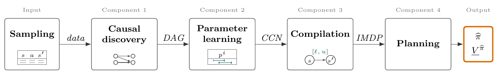

# Causal Model-Based Reinforcement Learning through Interval MDPs

From offline rollouts, the pipeline learns a causal graph of the dynamics, bounds its conditional probability tables with confidence intervals, compiles an interval MDP and returns a policy with a lower bound on its value.



## Installation

The code needs Python 3.12 and [uv](https://docs.astral.sh/uv/) (`pip install --user uv`).

```bash
uv sync --extra discovery
.venv/bin/python -m pytest -q
```

The first command builds the environment from `uv.lock`. The second runs the tests, in about 2 minutes. We tested the code on macOS (arm64) and Linux (x86_64).

## Computational constraints

Each step of a run has its own limits: 600 s for causal discovery, learning and training, 300 s to compile the interval MDP, 400 s to solve it, and 6 GB of memory. A run that exceeds a limit counts as neither solved nor reliable. The scripts run as many jobs in parallel as the memory allows at 6 GB each; `SCM_TO_MDP_WORKERS=N` sets the number of jobs.

We ran the experiments on a server with two Intel Xeon Gold 6248 CPUs (40 cores), 125 GiB of RAM and an NVIDIA A40 GPU. Only offline DQN and CQL use the GPU.

## Reproducing the experiments

Run the commands from the root of the repository. Results go to `results/clear27/` and figures to `outputs/clear27/`.

### Main experiments

```bash
.venv/bin/python experiments/clear27/run_pool.py sysadmin drone sepsis
.venv/bin/python experiments/clear27/plot.py sysadmin drone sepsis all_domains
```

### Reward ablation

```bash
bash experiments/clear27/ablations/ablation_rewards/run_all.sh
.venv/bin/python experiments/clear27/ablations/ablation_rewards/plot.py --domain all_domains
```

### Same-step ablation

```bash
bash experiments/clear27/ablations/ablation_same_step/run_all.sh
.venv/bin/python experiments/clear27/ablations/ablation_same_step/plot.py
```

### KWIK thresholds ablation

```bash
bash experiments/clear27/ablations/ablation_kwik_thresholds/run_all.sh
.venv/bin/python experiments/clear27/ablations/ablation_kwik_thresholds/plot.py
```

### Box against exact set ablation

```bash
bash experiments/clear27/ablations/ablation_box_exact/run_all.sh
.venv/bin/python experiments/clear27/ablations/ablation_box_exact/plot.py
```
